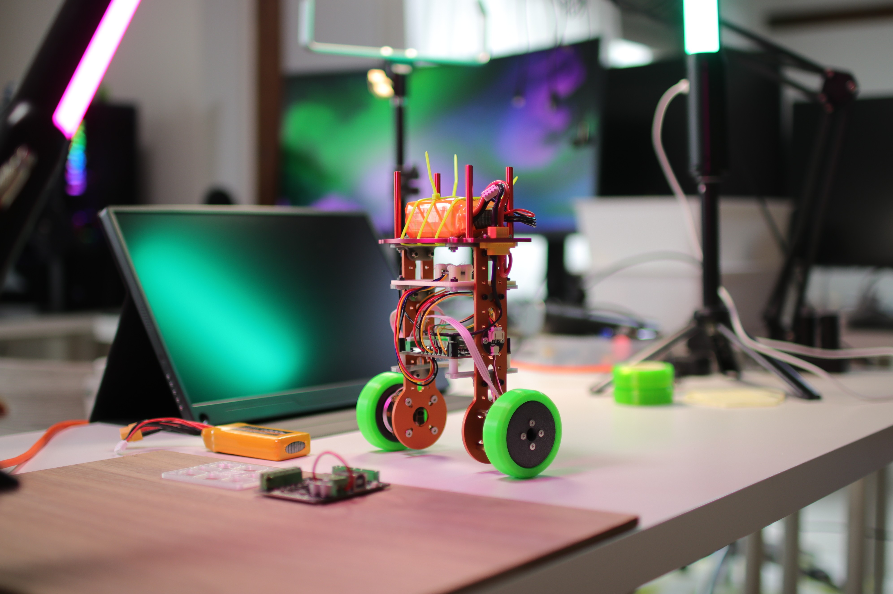

## 動画

| 動画プレビュー |
| :---: |
| ここにプロジェクトの紹介動画を掲載予定です。 |

<!-- 動画の準備ができたら、この欄をサムネイル画像と動画へのリンクに置き換えます。 -->

# Self-Balancing Car

[English](README.md) | **日本語**



ESP32、SimpleFOC、ジンバル用 BLDC モーターで作る2輪のセルフバランシングロボットです。BNO055 用ファームウェアと機械設計データを収録しています。

## ハードウェアと制御

- MKS ESP32 FOC V1.0（ESP32 / Arduino フレームワーク）
- ジンバル用 BLDC モーター2個と AS5600 磁気エンコーダー2個
- BNO055 姿勢センサー（I2C アドレス `0x29`）
- SimpleFOC によるモーター制御と、Wi-Fi の Web 調整画面

モーター制御は Core 1、Wi-Fi タスクは Core 0 で動作します。BNO055 を使うバランス制御の周期設定は 10 ms（100 Hz）です。

## フォルダ構成

| フォルダ | 内容 |
| --- | --- |
| [`hardware/`](hardware/) | 車体部品の STEP 形式の CAD データ。 |
| [`pics/`](pics/) | プロジェクトの写真。 |
| [`software/balancing_web_control/`](software/balancing_web_control/) | 最初に使う推奨版。バランス制御に加え、Web 画面から前後移動・旋回を操作できます。 |
| [`software/balancing/`](software/balancing/) | Web 画面でゲイン調整ができるバランス制御用ファームウェア。 |

### ハードウェアデータ

部品モデル（STEP 形式）：

| ファイル | 内容 |
| --- | --- |
| [`hardware/connector.step`](hardware/connector.step) | コネクターの CAD データ。 |
| [`hardware/leg.step`](hardware/leg.step) | 脚の CAD データ。 |
| [`hardware/sensor_tray_bno055.step`](hardware/sensor_tray_bno055.step) | BNO055 用センサートレーの CAD データ。 |
| [`hardware/tire.step`](hardware/tire.step) | タイヤの CAD データ。 |
| [`hardware/top.step`](hardware/top.step) | 上部部品の CAD データ。 |
| [`hardware/wheel_2804.step`](hardware/wheel_2804.step) | 2804 モーター用ホイールの CAD データ。 |

STEP 対応の CAD ソフトで開いてください。3Dプリントする場合は、必要な部品を STL など、使用するスライサーに対応した形式へ書き出してください。

### ファームウェアの主なファイル

両プロジェクトの基本構成は共通です。

| ファイル | 役割 |
| --- | --- |
| `platformio.ini` | 対象ボード、依存ライブラリ、書き込み・シリアルモニター設定。 |
| `src/main.cpp` | ハード初期化、モーター制御、バランス制御。Web 操作版では走行制御も担当。 |
| `src/config.h` | モーター定数、制御周期、制御パラメーター。 |
| `src/shared_state.h` / `src/shared_state.cpp` | タスク間で共有するゲインとテレメトリ。Web 操作版では走行指令も含む。 |
| `src/web_ui.h` / `src/web_ui.cpp` | Wi-Fi AP、Web 画面、HTTP ハンドラー。 |
| `src/wifi_config.example.h` | ローカルで設定する AP 接続情報のテンプレート。 |

## 設定とビルド

PlatformIO を使います。リポジトリ直下から推奨版のフォルダへ移動し、ローカル用の Wi-Fi 設定を作成します。

```powershell
cd software/balancing_web_control
Copy-Item src/wifi_config.example.h src/wifi_config.h
```

`src/wifi_config.h` を編集し、パスワードの仮文字列を自分用の半角 ASCII 8〜63文字のパスワードに置き換えてください。これはロボット自身のアクセスポイント設定であり、自宅ルーターへの接続情報ではありません。`wifi_config.h` は Git の追跡対象外で、実際の接続情報は配布しません。このファイルを作成してからビルドしてください。

```powershell
pio run
pio run -t upload
pio device monitor
```

起動後、スマートフォンや PC を `wifi_config.h` で設定した SSID（テンプレートでは `BalanceCar`）へ接続し、`http://192.168.4.1` を開くと Web 画面を利用できます。シリアルモニターは 115200 baud です。

FOC 初期化時に車輪が回るため、起動時は車体を確実に支え、車輪の周囲を空けてください。Web 画面には個別のログイン機能がなく、ロボットの AP に接続した端末から操作できます。AP のパスワードは自分用に設定し、信頼できる相手だけに共有してください。

バランス制御のみのファームウェアを使う場合は、リポジトリ直下から `software/balancing` へ移動し、同じ設定・ビルド手順を実行してください。

### 配線の参照

以下はコードに記載された ESP32 の GPIO 番号です。書き込み前に実際の基板・配線と照合してください。

| 接続 | GPIO / 設定 |
| --- | --- |
| 右モータードライバー | PWM: 32, 33, 25 / Enable: 22 |
| 左モータードライバー | PWM: 26, 27, 14 / Enable: 12 |
| 右 AS5600 + BNO055 の I2C | SDA: 19 / SCL: 18 |
| 左 AS5600 の I2C | SDA: 23 / SCL: 5 |
| 電源電圧の設定値 | コード上は 12 V。実際のハードに合わせて確認 |

使用前に、配線・モーターの向き・制御ゲイン・モーター制限値を自作機に合わせて確認してください。

## ライセンス

Copyright (c) 2026 kawashimaken.

| 対象 | ライセンス |
| --- | --- |
| `software/` 内の自作ソフトウェアとルートの README | [MIT](software/LICENSE) |
| `hardware/` 内の自作ハードウェア設計データ | [CERN-OHL-P-2.0](hardware/LICENSE) |

どちらも、それぞれの条件に従って商用利用・改変・再配布ができます。ファイルを共有する際は、適用されるライセンスと著作権表示を保持してください。外部ライブラリなど第三者の著作物には、それぞれのライセンスが適用されます。詳しくは[適用範囲の説明](LICENSE)を参照してください。
