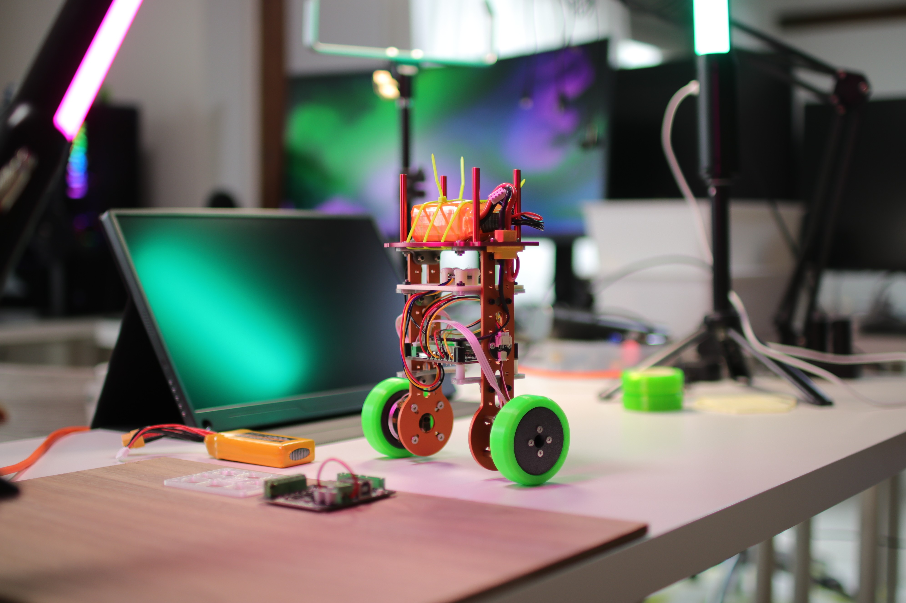

## Video

<div align="center">
  <div align="center">
  <a href="https://youtu.be/T2_N7V6W7gY" target="_blank" rel="noopener noreferrer">
    
  </a>
</div>
</div>

# Self-Balancing Car

**English** | [日本語](README.ja.md)



Build your own two-wheel self-balancing robot with ESP32, SimpleFOC, and gimbal BLDC motors. This repository contains BNO055 firmware and mechanical design files.

## Hardware and control

- MKS ESP32 FOC V1.0 (ESP32 / Arduino framework)
- Two gimbal BLDC motors and two AS5600 magnetic encoders
- BNO055 motion sensor, using I2C address `0x29`
- SimpleFOC for motor control, with a Wi-Fi web interface for tuning

Motor control runs on Core 1 and the Wi-Fi task on Core 0. The BNO055 balance-control interval is set to 10 ms (100 Hz).

## Folder structure

| Folder | Contents |
| --- | --- |
| [`hardware/`](hardware/) | STEP CAD models for the mechanical parts. |
| [`pics/`](pics/) | Project photos. |
| [`software/balancing_web_control/`](software/balancing_web_control/) | Recommended starting point: balancing firmware with forward/reverse and turning commands from the web interface. |
| [`software/balancing/`](software/balancing/) | Balancing firmware with web-based gain tuning. |

### Hardware files

Part models (STEP format):

| File | Contents |
| --- | --- |
| [`hardware/connector.step`](hardware/connector.step) | Connector CAD model. |
| [`hardware/leg.step`](hardware/leg.step) | Leg CAD model. |
| [`hardware/sensor_tray_bno055.step`](hardware/sensor_tray_bno055.step) | Sensor-tray CAD model for the BNO055. |
| [`hardware/tire.step`](hardware/tire.step) | Tire CAD model. |
| [`hardware/top.step`](hardware/top.step) | Top-part CAD model. |
| [`hardware/wheel_2804.step`](hardware/wheel_2804.step) | Wheel CAD model for a 2804 motor. |

Open the STEP files in a compatible CAD application. For 3D printing, export the required parts as STL or another format supported by your slicer.

### Firmware files

Each firmware project contains:

| File | Purpose |
| --- | --- |
| `platformio.ini` | Board, library dependencies, upload, and serial-monitor settings. |
| `src/main.cpp` | Hardware initialization, motor control, and balancing logic; the web-control variant also handles driving. |
| `src/config.h` | Motor constants, control timing, and control parameters. |
| `src/shared_state.h` / `src/shared_state.cpp` | Gains, telemetry, and, in the web-control variant, driving commands shared between tasks. |
| `src/web_ui.h` / `src/web_ui.cpp` | Wi-Fi access point, web interface, and HTTP handlers. |
| `src/wifi_config.example.h` | Template for local access-point credentials. |

## Setup and build

Use PlatformIO. From the repository root, enter the recommended firmware project and create your local Wi-Fi configuration:

```powershell
cd software/balancing_web_control
Copy-Item src/wifi_config.example.h src/wifi_config.h
```

Edit `src/wifi_config.h` and replace the password placeholder with your own password of 8–63 ASCII characters. These settings configure the robot's access point, not a connection to your home router. `wifi_config.h` is intentionally ignored by Git; actual credentials are not distributed. Building requires this file.

```powershell
pio run
pio run -t upload
pio device monitor
```

After startup, connect your phone or computer to the SSID configured in `wifi_config.h` (the template uses `BalanceCar`). Open `http://192.168.4.1` to access the web interface. The serial-monitor baud rate is 115200.

FOC initialization can rotate the wheels: support the robot securely and keep the wheels clear when powering up. The web interface has no separate login; devices connected to the robot's access point can operate it. Use your own AP password and share it only with trusted users.

To build the balancing-only firmware, start from the repository root, enter `software/balancing`, and follow the same configuration and build steps.

### Wiring reference

These are ESP32 GPIO numbers taken from the firmware. Check your actual board and wiring before uploading.

| Connection | GPIO / setting |
| --- | --- |
| Right motor driver | PWM: 32, 33, 25; enable: 22 |
| Left motor driver | PWM: 26, 27, 14; enable: 12 |
| Right AS5600 + BNO055 I2C bus | SDA: 19; SCL: 18 |
| Left AS5600 I2C bus | SDA: 23; SCL: 5 |
| Power-supply setting | 12 V in firmware; verify against your hardware |

Check wiring, motor direction, control gains, and motor limits for your hardware before use.

## License

Copyright (c) 2026 kawashimaken.

| Material | License |
| --- | --- |
| Original software under `software/` and the root README files | [MIT](software/LICENSE) |
| Original hardware design files under `hardware/` | [CERN-OHL-P-2.0](hardware/LICENSE) |

Both licenses permit commercial use, modification, and redistribution subject to their terms. Keep the applicable license and copyright notices when sharing the files. Third-party libraries and other third-party material retain their own licenses. See the [licensing scope](LICENSE) for details.
